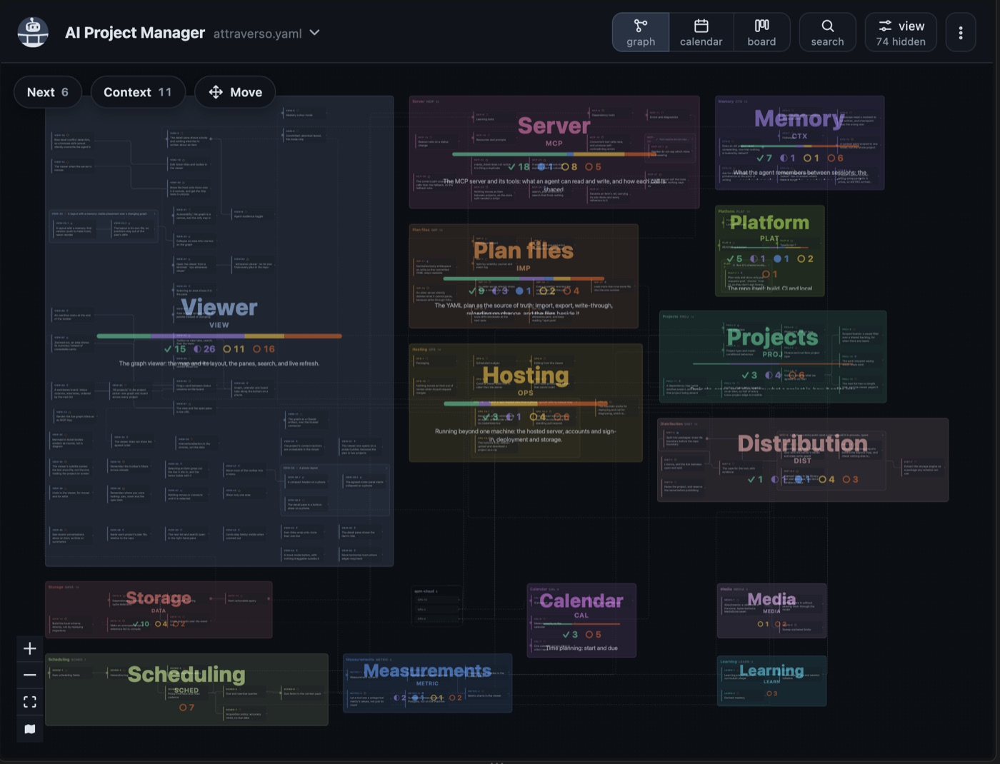
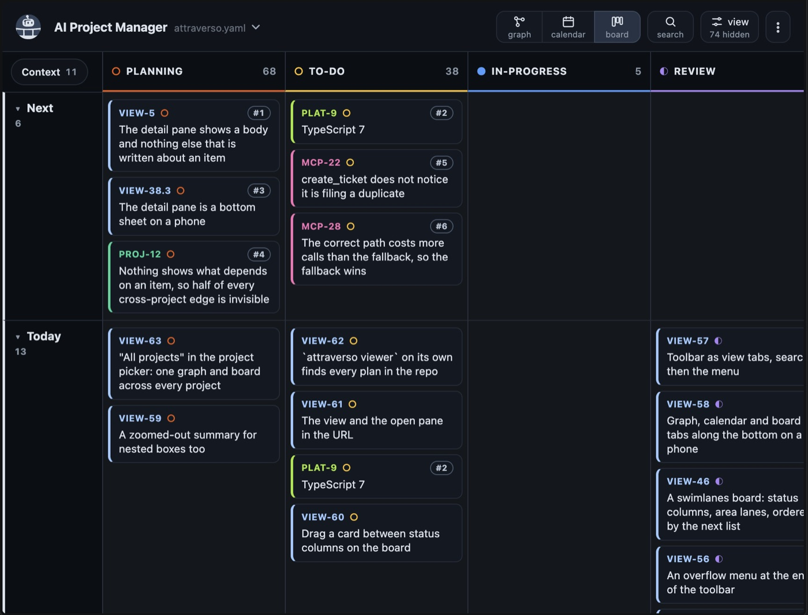
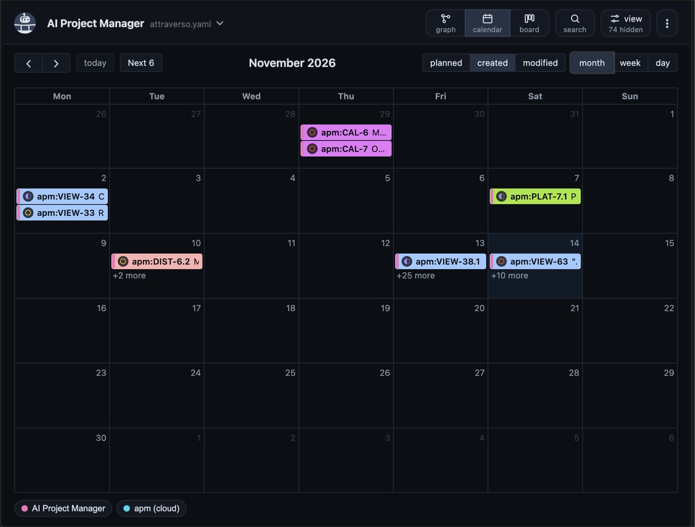
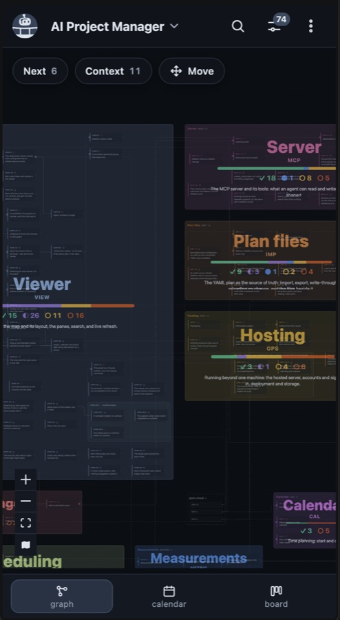

# attraverso

Durable, structured project memory for AI coding agents, over [MCP](https://modelcontextprotocol.io): the plan,
the reasoning behind it and what was decided, kept in your repo and shown as a graph, a board and a calendar.

## Why

An agent is good at working on a project and bad at remembering it three weeks later. The usual workaround is
a `CLAUDE.md` file that grows unmaintainably, cannot be queried, and rots. Attraverso moves that state into a
real store: the plan, the reasoning behind it, and the record of what was decided - retrieved as a
budget-bounded slice rather than dumped into context wholesale.

The plan lives as version-controlled YAML committed alongside your code, so it is reviewable in a pull request
like any other file, and is rebuilt into an in-memory Postgres ([PGlite](https://pglite.dev)) on load.

## Quick start

Needs Node 22 or newer. In your repo, with [Claude Code](https://claude.com/claude-code):

```bash
npm install --save-dev attraverso && claude mcp add --scope project attraverso -- npx attraverso
# installs attraverso and adds its server to the repo's .mcp.json
```

With yarn, `yarn add --dev attraverso` in place of the `npm install`.

Claude Code loads its servers when a session starts, so start a new one (or restart one already open) and approve
the attraverso server when it asks. Then tell the agent something like:

> Create an attraverso project for this repo, and add items for what we're working on.

And see the plan:

```bash
npx attraverso viewer --open
```

| | |
| :-: | :-: |
|  |  |
| **Graph**: items by dependency, grouped by area | **Board**: status columns, the agreed order first |
|  |  |
| **Calendar**: planned dates, or when items were filed or changed | **Phone**: the same views, tabs along the bottom |

## Using it

### In Claude Code

The quick start's `claude mcp add` writes this to the `.mcp.json` at the root of your repo, which you can also
add by hand:

```json
{
  "mcpServers": {
    "attraverso": {
      "command": "npx",
      "args": ["attraverso"]
    }
  }
}
```

To try it without installing, make the args `["-y", "attraverso"]`: `npx` then fetches the latest release on first
run instead of using the repo's pinned copy.

The plan, `attraverso.yaml`, is created at the root of the repo on first run. Commit it: it is the source of
truth, and its diffs are the history of the plan. Readings, attachments and the graph's layout go in an
`.attraverso/` folder beside it, committed too.

Then ask the agent to call `get_project`, or just to create a project and start planning. The tools describe
themselves, and `get_project` returns the project's protocol - its operating manual - first.

### Seeing it

Ask the agent to open the viewer (the `open_viewer` tool), or open it yourself from a terminal, in the project:

```bash
npx attraverso viewer --open
```

Either way it serves the plan on a `127.0.0.1` address, so it only opens on the machine running it. The terminal
command finds the plan the way the server does (or takes `--store <path>`), prints the URL, and opens it with
`--open`. `--project <key>` picks which project it lands on. It can edit the plan as the agent's viewer can, and
is safe to run beside a connected server on the same file. Ctrl+C stops it.

### Where the plan lives

In order of precedence:

1. `--store <path>` (repeatable: a plan can span several files), or `APM_STORE_PATH`.
2. The nearest `attraverso.yaml` found walking up from the working directory, like `tsconfig.json`. Inside a git
   repo the search stops at the repo's root.
3. In a git repo with no plan yet, `attraverso.yaml` at the repo's root, created on first run.
4. Outside any repo, `~/.ai-project-manager/attraverso.yaml`, for a personal project with no repo to live in.

To keep the plan somewhere else - under another name, in a subfolder, or one file shared by several repos -
name it with `--store`. A relative path is resolved from the repo root, where Claude Code starts the server:

```json
"args": ["-y", "attraverso", "--store", "../plans/shared.yaml"]
```

Repeat `--store` to load a plan split across files; the first one named is where new projects go.

**Plan files from before 0.1.2 are named `*.apm.yaml`**, with their data in `.apm/`. They are still found and
loaded, and always will be. To move one over, rename both: `git mv roadmap.apm.yaml attraverso.yaml` and
`git mv .apm .attraverso`.

### Claude Desktop

Claude Desktop starts servers without your shell's `PATH`, so a bare `npx` or `node` is often not found. See
[docs/claude-desktop.md](docs/claude-desktop.md) for the setup and the three ways it silently breaks.

### From a program

A program can open a plan in-process and call it with typed functions, without the MCP server. It runs in Node
and in a browser: the plan comes in as YAML text and goes out through a callback after every change, so where
it is kept (a file, IndexedDB, the origin-private file system) is up to you.

```ts
import { openPlan } from "attraverso/library";

const plan = await openPlan({ yaml: savedText, save: (yaml) => store(yaml) });
const project = await plan.project("spanish");
const item = await project.createItem({ area: "VERB", title: "The subjunctive" });
await project.addComment(item.ref, "Mixed it up with the conditional again.");
```

Keep one writer per plan: don't run the MCP server on the same file while a program has it open. In a Vite app,
add `optimizeDeps: { exclude: ["@electric-sql/pglite"] }` to the config so the dev server serves PGlite's WASM.

## Developing

```sh
yarn install
yarn verify          # typecheck, viewer build, unit tests
yarn verify:all      # plus the end-to-end suite (once: npx playwright install chromium)
yarn viewer          # the graph on http://localhost:5176
yarn build:standalone && yarn test:package   # the packed package, used from Node, NodeNext types and a browser
```

`yarn test:pg` runs the same suite against a server Postgres (`yarn pg:up` starts one in Docker).

To try a change against a real plan, run the server from source over any store: `yarn mcp:dev --store
<path>`, or point a `.mcp.json` at `node_modules/.bin/vite-node src/mcp/server.ts`.

Releasing is `yarn release` (`--dry-run` to rehearse), from an up-to-date checkout of this repo: it verifies,
builds, checks the build starts with clean stdout and that the library works once installed, publishes to npm
and tags the version. The server in the published package is a single self-contained build that needs nothing
installed but Node; the library beside it declares its own dependencies.

## How this repo is maintained

Attraverso is developed in a private repository alongside a hosted version, and the open core is mirrored here
automatically. Issues and pull requests are welcome here; a merged pull request is carried across to the
private repository with its authorship kept, and comes back out in the next export.

## Licence

[Apache-2.0](LICENSE).
